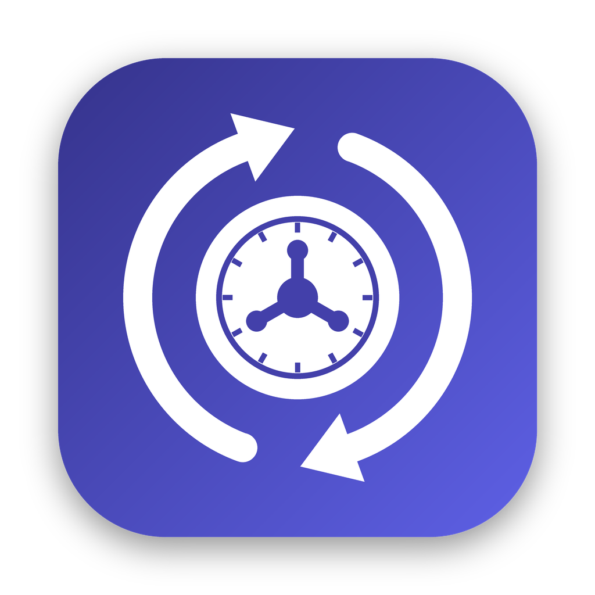

<p align="center">
  
</p>

<h1 align="center">VaultWatch</h1>

<p align="center">
  <a href="https://github.com/gurusince88/VaultWatch/releases/latest"></a>
  <a href="https://github.com/gurusince88/VaultWatch/actions/workflows/build.yml"></a>
</p>

<p align="center">
  A small macOS menu bar app that keeps <a href="https://help.obsidian.md/headless">Obsidian Headless Sync</a> running in the background, and shows you what it's syncing.
</p>

---

VaultWatch runs `ob sync --path <vault> --continuous` for each of your vaults, keeps it alive, and puts its status in the menu bar. No Terminal window to leave open, no launchd plists to write.

> VaultWatch is an independent project. It is not made by or affiliated with Obsidian. It needs the official `obsidian-headless` CLI and an Obsidian Sync subscription.

## Features

- **Menu bar status**: `ob ✓` up to date, `ob …` syncing, `ob !` needs attention, `ob ⏸` paused.
- **Activity view**: every file `ob` uploads, downloads, merges, or deletes, with today's counts. Filter by type or file name; double-click to reveal in Finder or open in Obsidian.
- **Keeps sync alive**: restarts `ob` if it crashes (2s → 5s → 15s → 60s → 120s backoff), stops and notifies after 5 failures in a row.
- **Safe shutdown**: stops `ob` with SIGTERM on quit, logout, and sleep, and restarts it after wake.
- **One sync per vault**: refuses to start a second `ob sync` on the same vault, and offers **Take Over** if one is already running in Terminal.
- **Finds your vaults**: on first launch, imports every vault you've set up with `ob sync-setup`.
- **Continuous or interval**: `--continuous` watching, or a sync every 1–60 minutes.
- **Logs**: per-vault log files in `~/Library/Logs/VaultWatch/` (rotated at 5 MB) plus a live log window.
- **Launch at Login** toggle.

## Requirements

- macOS 13 Ventura or later
- Xcode or the Command Line Tools (`xcode-select --install`) to build
- Node.js 22+ and the Obsidian Headless CLI:

  ```bash
  npm install -g obsidian-headless
  ob login
  ob sync-setup --vault "My Vault" --path ~/path/to/vault
  ```

> Don't run desktop Obsidian Sync and Headless Sync on the same vault on the same Mac. Obsidian warns this can cause conflicts. Back up your vault before the first sync.

## Install

### Download (recommended)

1. Grab `VaultWatch-x.y.z.zip` from the [latest release](https://github.com/gurusince88/VaultWatch/releases/latest) and unzip it.
2. Drag **VaultWatch.app** to **Applications** and open it.
3. Open the menu bar item, click the gear, and turn on **Launch at Login**.

If macOS says it can't verify the app (builds that aren't notarized yet), open **System Settings → Privacy & Security** and click **Open Anyway**.

If you're already running `ob sync --continuous` in a Terminal, stop it first (Ctrl-C) or click **Take Over** in the menu.

### Build from source

```bash
git clone https://github.com/gurusince88/VaultWatch.git
cd VaultWatch
./build.sh --install
open /Applications/VaultWatch.app
```

The first build takes 1–3 minutes.

### Releasing

Bump the `VERSION` file (e.g. `0.4.0`), add notes in `docs/releases/v0.4.0.md`, and push to `main`. The [Build & Release workflow](.github/workflows/build.yml) builds a universal app, creates the `v0.4.0` tag, and publishes the release. Pushing a `v*` tag yourself works too. With these repository secrets set, the app is also signed with your Developer ID and notarized:

| Secret | Value |
|---|---|
| `MACOS_CERTIFICATE` | Base64 of your **Developer ID Application** certificate exported as `.p12` |
| `MACOS_CERTIFICATE_PWD` | Password you set when exporting the `.p12` |
| `NOTARY_KEY` | App Store Connect API key (`.p8` contents, raw or base64) |
| `NOTARY_KEY_ID` | That key's Key ID |
| `NOTARY_ISSUER_ID` | Your App Store Connect Issuer ID |

Instead of the API key you can use `APPLE_ID`, `APPLE_APP_PASSWORD` (an app-specific password), and `APPLE_TEAM_ID`.

## Test

`test.sh` builds, installs, and checks the app against a real vault: it spawns `ob` correctly, restarts after a crash, refuses duplicates, and shuts down without leaving `ob` orphaned.

```bash
./test.sh                         # first vault from `ob sync-list-local`
./test.sh ~/path/to/vault         # a specific vault
./test.sh ~/path/to/vault --activity   # also syncs and deletes a small test note
```

## How it works

| Piece | What it does |
|---|---|
| `BinaryResolver` | Finds `ob` and `node` (Homebrew, nvm, fnm, Volta, or your login shell), since GUI apps don't get your shell `PATH` |
| `VaultSupervisor` | One per vault: preflight with `ob sync-status`, spawn, restart with backoff, SIGTERM shutdown, duplicate guard, parses output |
| `SyncEventParser` | Turns `ob` lines like `Upload complete Notes/today.md` into activity events |
| `ActivityStore` | Keeps the last 1,000 events; rebuilds history from the log files on launch |
| `AppModel` / `MenuView` / `ActivityView` | SwiftUI menu bar UI and windows |

Settings live in `~/Library/Application Support/VaultWatch/config.json`.

`ob login` and `ob sync-setup` need your password and 2FA, so VaultWatch opens them in Terminal instead of handling credentials itself.

## Known limits

- `ob` has no machine-readable progress output, so activity comes from parsing its log lines. A future `ob` release could change them.
- Ad-hoc signed for local builds. Sharing a prebuilt app needs Developer ID signing and notarization.
- Not sandboxed (it has to launch `ob`), so it can't go on the Mac App Store.

## Regenerating the icon

```bash
pip install pillow
python3 scripts/make_icon.py
```

## License

MIT. See [LICENSE](LICENSE).
